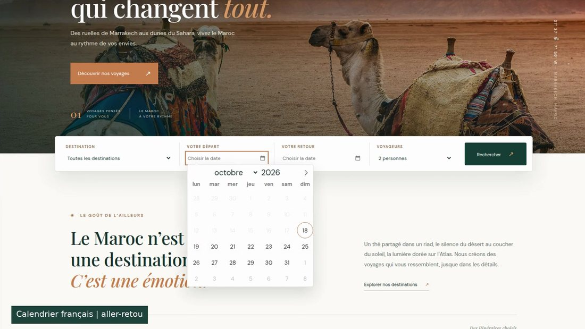
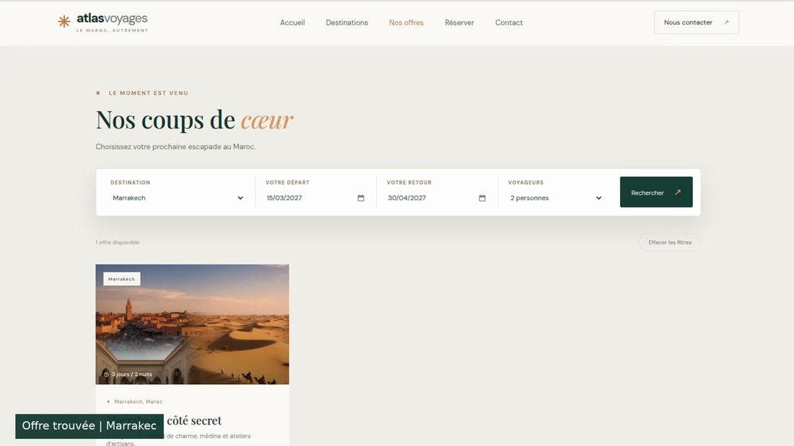
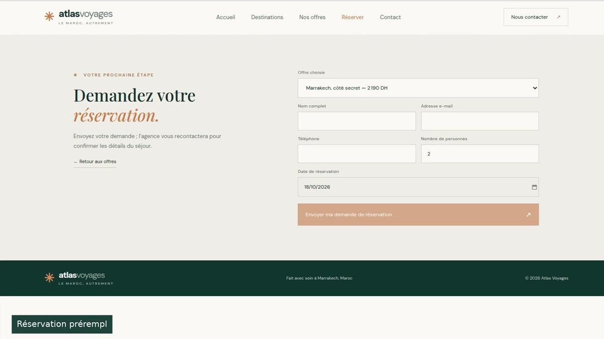
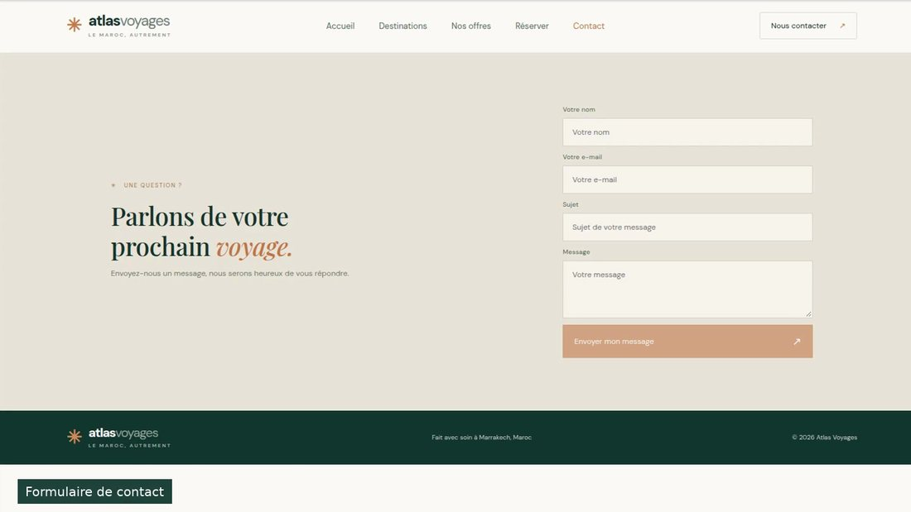

# Atlas Voyages — Angular, Laravel et MySQL

Application web responsive en français pour une agence de voyages fictive. L’interface Angular consulte les destinations et offres fournies par une API REST Laravel. Les demandes de réservation et les messages de contact sont validés puis enregistrés dans MySQL.

> Les tarifs, descriptions, dates et coordonnées d’exemple sont fictifs et destinés à la démonstration pédagogique.

## Apercu visuel

Les images ci-dessous sont des captures de la démonstration. [Ouvrir la vidéo complète (21 secondes)](verification/demo-frontend.mp4).

**Accueil et recherche**


**Calendrier français**



**Offres filtrées par destination et dates**



**Réservation**



**Contact**



## Fonctionnalités

- Liste des destinations touristiques et des offres depuis l’API.
- Barre de recherche sur l’accueil et filtres des offres par destination, dates de départ/retour et nombre de voyageurs. Les dates sélectionnées filtrent les offres selon leur date de départ.
- Formulaire de réservation : nom, e-mail, téléphone, offre, nombre de personnes et date de réservation.
- Formulaire de contact : nom, e-mail, sujet et message.
- Validation côté navigateur et côté Laravel ; les formulaires affichent les erreurs de validation renvoyées par l’API.
- Calendrier de dates en français (Flatpickr) sur l’accueil, les filtres d’offres et la réservation ; dates de départ/retour et nombre de voyageurs transmis à la recherche.
- Styles responsive conservés dans `frontend/src/styles.css` et lisibles directement dans GitHub.
- Données d’exemple pour cinq destinations et cinq offres via un seeder réexécutable.
- Si l’API Laravel ne répond pas, l’interface garde quelques cartes de démonstration et affiche un avertissement ; les formulaires ne peuvent toutefois pas enregistrer sans le backend.
- API REST CRUD pour les destinations, offres, réservations et contacts.
- Navigation Angular par routes vers cinq pages séparées : accueil, destinations, offres, réservation et contact.

## Architecture

```text
atlas-voyages/
├── frontend/                         # Angular 21 / TypeScript
│   ├── src/styles.css                  # Styles globaux et responsive
│   └── src/app/
│       ├── app.routes.ts               # Routes Angular
│       ├── components/                 # Barre de navigation et pied de page
│       ├── pages/                      # Accueil, destinations, offres, réservation, contact
│       ├── interfaces/models.ts         # Types TypeScript
│       └── services/                   # Appels HttpClient vers Laravel
└── backend/                          # API Laravel 12 / PHP 8.2+
    ├── app/Models/                    # Destination, Offre, Reservation, Contact
    ├── app/Http/Controllers/Api/      # Contrôleurs REST et validation
    ├── database/migrations/           # Schéma relationnel MySQL
    ├── database/seeders/              # Destinations et offres de démonstration
    └── routes/api.php
```

Flux : navigateur Angular (`http://localhost:4200`) → `/api` via le proxy Angular en développement → API Laravel (`http://localhost:8000`) → MySQL.

## Prérequis

- Node.js 20.19+ ou 22.12+, et npm.
- PHP 8.2+, Composer, MySQL 8+ (ou une version compatible) et l’extension PDO MySQL activée.
- Deux terminaux pour exécuter les serveurs frontend et backend.

## Installation et lancement

### 1. Créer la base de données

Dans MySQL, créer une base nommée `agence_voyage` :

```sql
CREATE DATABASE agence_voyage CHARACTER SET utf8mb4 COLLATE utf8mb4_unicode_ci;
```

### 2. Installer et démarrer Laravel

Depuis la racine du projet :

```bash
cd backend
composer install
cp .env.example .env
php artisan key:generate
```

Modifiez `backend/.env` si les identifiants MySQL diffèrent de votre configuration :

```dotenv
DB_CONNECTION=mysql
# Loopback local vers MySQL sur ce même ordinateur ; ce n’est pas une IP publique.
DB_HOST=127.0.0.1
DB_PORT=3306
DB_DATABASE=agence_voyage
DB_USERNAME=root
DB_PASSWORD=
FRONTEND_URL=http://localhost:4200
```

Puis exécutez les migrations, insérez les données de démonstration et lancez l’API :

```bash
php artisan migrate --seed
php artisan serve
```

L’API écoute sur `http://localhost:8000`. La liste des routes se vérifie avec `php artisan route:list --path=api`.

### 3. Installer et démarrer Angular

Dans un deuxième terminal, depuis la racine du projet :

```bash
cd frontend
npm ci
npm start
```

Ouvrez `http://localhost:4200`. Le proxy de `frontend/proxy.conf.json` transmet les appels `/api` à Laravel sur `localhost:8000`. Si le backend utilise un autre port, ajustez la cible du proxy puis redémarrez Angular. En production, servez `/api` sur la même origine via un reverse proxy ou configurez une URL d’API adaptée dans `environment.ts`.

### Windows PowerShell

Depuis la racine du projet, utilisez `Copy-Item backend/.env.example backend/.env`, puis exécutez depuis le dossier `backend` les commandes `composer install`, `php artisan key:generate`, `php artisan migrate --seed` et `php artisan serve`. Dans un deuxième PowerShell, allez dans `frontend`, puis lancez `npm install` et `npm start`. La base `agence_voyage` doit exister et les identifiants doivent être configurés dans `backend/.env` avant la migration.

## API REST

Toutes les ressources prennent en charge les méthodes Laravel `GET` (liste et détail), `POST`, `PUT/PATCH` et `DELETE` :

| Ressource | Endpoint de base | Relation / usage |
|---|---|---|
| Destinations | `/api/destinations` | Une destination possède plusieurs offres. |
| Offres | `/api/offres` | Une offre appartient à une destination. |
| Réservations | `/api/reservations` | Une réservation concerne une offre. |
| Contacts | `/api/contacts` | Messages envoyés par les visiteurs. |

Exemples : `GET /api/destinations`, `GET /api/offres/1`, `POST /api/reservations`, `POST /api/contacts`.

Les requêtes `POST`, `PUT` et `PATCH` utilisent `Content-Type: application/json` et un corps JSON. La validation Laravel retourne les erreurs au format JSON avec le statut HTTP `422`.

### Exemple de réservation

```json
{
  "offre_id": 1,
  "nom_client": "Ahmed",
  "email": "ahmed@example.com",
  "telephone": "0612345678",
  "nombre_personnes": 2,
  "date_reservation": "2026-11-15"
}
```

### Exemple de contact

```json
{
  "nom": "Sara",
  "email": "sara@example.com",
  "sujet": "Séjour à Marrakech",
  "message": "Je souhaite recevoir des informations sur cette offre."
}
```

### Essais rapides avec curl

```bash
curl http://localhost:8000/api/destinations
curl http://localhost:8000/api/offres
curl -X POST http://localhost:8000/api/reservations \
  -H 'Content-Type: application/json' -H 'Accept: application/json' \
  -d '{"offre_id":1,"nom_client":"Ahmed","email":"ahmed@example.com","telephone":"0612345678","nombre_personnes":2,"date_reservation":"2026-11-15"}'
curl -X POST http://localhost:8000/api/contacts \
  -H 'Content-Type: application/json' -H 'Accept: application/json' \
  -d '{"nom":"Sara","email":"sara@example.com","sujet":"Séjour","message":"Je souhaite des informations."}'
```

## Vérifications

- Tests API Laravel sur SQLite en mémoire : `cd backend && composer test`.
- Audit des dépendances PHP : `cd backend && composer audit`.
- Construction frontend : `cd frontend && npm ci && npm run build`.
- Audit des dépendances JavaScript : `cd frontend && npm audit`.
- Routes Laravel : `cd backend && php artisan route:list --path=api`.
- Migrations et seed : `cd backend && php artisan migrate:fresh --seed` (supprime et recrée les tables ; à réserver à une base de développement).
- Collection Postman importable : `postman/Atlas-Voyages.postman_collection.json` (10 requêtes, assertions HTTP ; exécutée avec Newman : 13 assertions réussies, 0 échec ; rapport dans `verification/postman-newman-report.json`).
- Captures Chromium des cinq pages, du rendu mobile, du calendrier français et d’une recherche filtrée : `verification/captures/`.
- Vidéo de présentation du frontend : [`verification/demo-frontend.mp4`](verification/demo-frontend.mp4) (21 secondes, 1440 × 810, sans audio).
- Guide de démonstration : `DEMONSTRATION.md`.
- Le workflow GitHub Actions compile Angular et exécute la suite PHPUnit à chaque push et pull request.
- Validation complémentaire effectuée sous MySQL 8.0 : migrations et seed, requêtes GET des destinations/offres, POST réservation/contact et présence des enregistrements. Les tests automatisés PHPUnit continuent d’utiliser SQLite en mémoire.
- Pour une remise sur votre ordinateur, importer et exécuter la collection dans Postman, vérifier vos paramètres MySQL et ajouter une capture du Runner Postman Desktop si celle-ci est exigée par le professeur.

## Limites du prototype pédagogique

- L’API expose actuellement les opérations de gestion CRUD sans authentification ; ne l’exposez pas telle quelle en production, en particulier pour la consultation ou la suppression des réservations et contacts.
- Les coordonnées, contenus et tarifs sont fictifs. Les images du dossier frontend doivent être utilisées selon leurs droits/licences.
- Il s’agit d’une demande de réservation : aucune confirmation de disponibilité ni de paiement en ligne n’est réalisée.
- Dans l’environnement de préparation, le build Angular, les tests SQLite, les échanges API MySQL 8 et le Runner Newman ont été exécutés. Le Runner Newman n’est pas une capture de Postman Desktop. Ajoutez vos renseignements personnels uniquement dans le rapport séparé demandé par votre établissement, pas dans le dépôt public.
